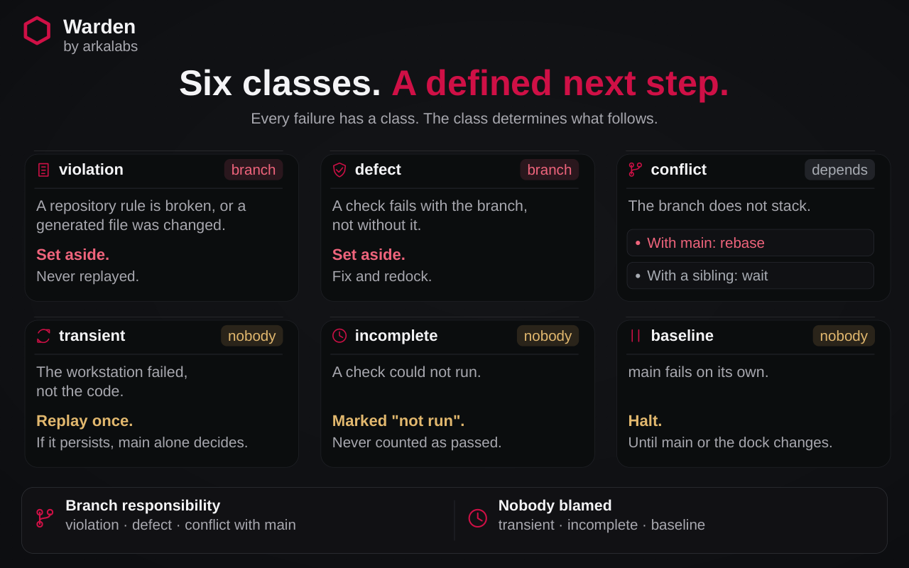
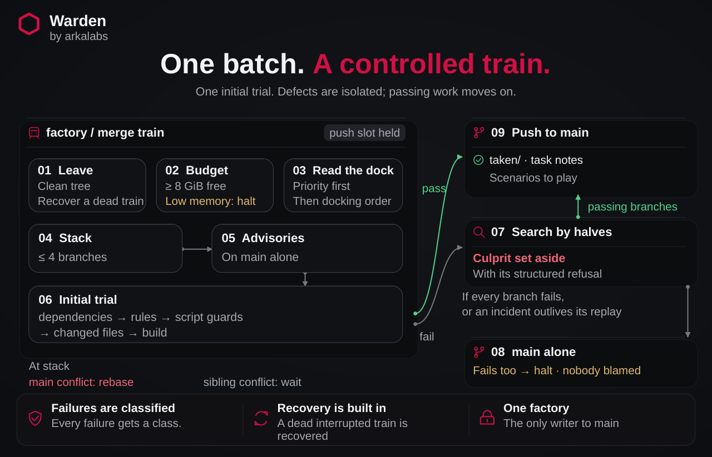
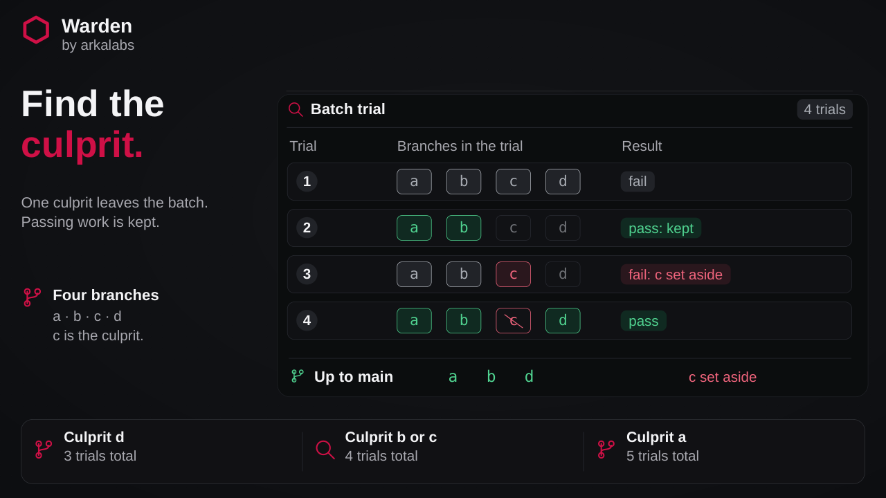
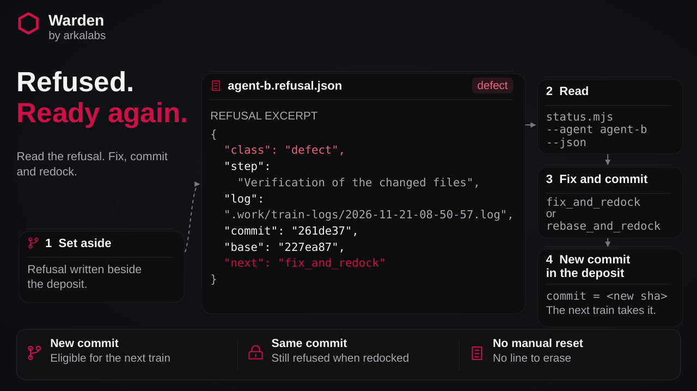
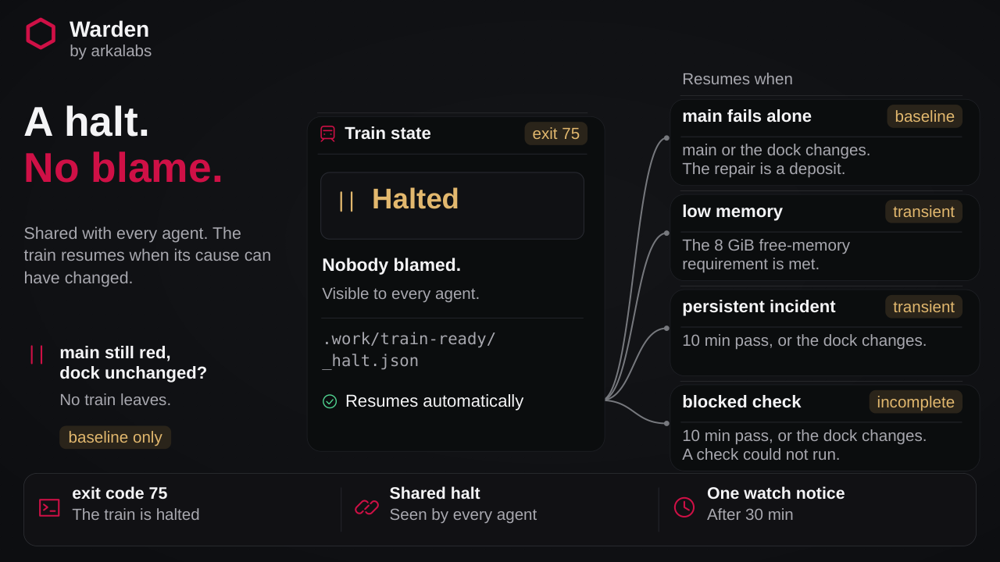

# Merge Train

## The push slot

One push to the main branch at a time on the workstation, for every tree of the project.

- **The lock** is a folder, because `mkdir` is atomic: `.work/push-slot/` at the main root. Its `held-by.txt` names the tree, the commit and the time.
- **The pre-push hook** takes the slot before verifying, and polls every 5 seconds while another tree holds it. A slot held by its own tree is taken back (an interrupted hook).
- **Abandon**: a slot held for more than 50 minutes is renamed aside, then taken by `mkdir` like a free one, so two hooks cannot both take it. The takeover is written to `slot.log` when one is set.
- **Keep-alive**: during a long verification, a detached process refreshes the time every 5 minutes, and ends with the verification.
- **Release**: the slot is given back as soon as the remote carries the commit, or after 3 minutes when the push failed after the hook.
- **Moved branch**: when the main branch moved since the rebase, the push is refused before any verification.

## Docking

A ready branch is rebased on the main branch, green on its own scope, and docked:

```
.work/train-ready/<session>.txt

tree     = <absolute path of the tree that carries the branch>
branch   = <branch name>
commit   = <the commit checked by its author>
tasks    = <task ids, comma separated>
docked   = <dd/mm hh:mm>
scenario = <journey scenario, when the change shows on screen>
priority = <number, only on the person's word>
```

Two pending deposits at most per agent. The train takes exactly the docked `commit`: commits added after docking were neither checked nor declared by the author. A deposit with no `commit` takes the branch tip, and the train says so.

## Classes



Every failed step gets one class, and the class decides what follows, without a person (`outcome.mjs`).

| Class | What it means | What follows |
|---|---|---|
| `violation` | A repository rule is broken, or a command changed a generated file | The branch is set aside; never replayed |
| `defect` | A check that ran fails with the branch, and not without it | The branch is set aside, with its step, first error and log |
| `conflict` | The branch does not stack | On the main branch: set aside, to rebase. On another branch of the batch: it waits |
| `transient` | The failure comes from the workstation: memory (os error 1455, LNK1102), a file held, a full disk, the network, a killed process | The step is replayed once. If it fails again, the main branch alone says whose it is |
| `incomplete` | A check asked for could not run: a tool absent, no advisory database | Never counted as passed: recorded "not run", or waiting, as `verify.when_missing` says |
| `baseline` | The main branch fails on its own | The train halts and blames nobody |

A project adds its own incident patterns with `verify.transient_patterns`.


## A train



`node scripts/warden/train.mjs run --agent <factory name>` runs one train. Exit code: 0 done, 1 stopped by an error, 75 halted.

1. **Leave**: the tree is clean, and it is the declared factory tree. A previous train left interrupted, whose process is gone, is recovered first. The train takes the slot.
2. **Budget**: below `train.min_free_memory_gib` of memory free to commit, the train halts. Otherwise it takes every core, bounded by the memory (`train.memory_per_job_gib` per job, `CARGO_BUILD_JOBS`), turns incremental compilation off (`CARGO_INCREMENTAL=0`), and takes the CPU priority (`priority.mjs`).
3. **Read the dock**: complete deposits that are not refused. Those with a `priority` come first, the lowest number first, then the docking order. When the train is halted on a red main branch, and neither the main branch nor the dock changed, it does not leave.
4. **Locate**: each branch is fetched from its tree. When the tree no longer exists, the local branch of the same name is taken, and the train says so. A deposit that cannot be read is set aside alone; the train goes on with the others.
5. **Stack**: each docked commit is cherry-picked onto the main branch. Commits already taken are skipped (`git cherry`). At most `train.max_batch` branches (4) go in one batch; the others wait. A branch the factory takes with `--with` is always taken, outside that count.
   - A branch that conflicts with the main branch is set aside, never resolved.
   - A branch that only conflicts with another branch of the batch waits. If that other branch goes up, the first one conflicts with the new main branch and is set aside then; otherwise it waits for the next train, with no refusal.
6. **Advisories on the main branch alone**: `verify.mjs advisories`. When they fail there, each trial checks them first: only a batch that repairs them goes up, and no branch is blamed for them.
7. **Trial**, always in this order:
   1. start again from the main branch (`checkout -f`);
   2. install the dependencies, when the lockfile changed;
   3. run the rules and the script guards (`guards.mjs`);
   4. verify the changed files (`verify.mjs files`);
   5. build once (`train.build`).
8. **Search by halves**: when the trial fails, the culprit is found by halves, and what already passed is not verified again. With one culprit in a batch of four, it takes three trials when the culprit came last, five when it came first.
9. **The main branch alone**: when every branch failed, or when an incident survived its replay, the main branch alone goes through the same checks, on the same files. When it fails too, the fault is not in the branches: the train halts and refuses nobody.
10. **Push**:
    - the commit is marked verified, so the hook does not verify it again;
    - deposits that went up move to `taken/`, with the commit taken and where it went;
    - each task gets a note; a check that was not run is named in it;
    - the train names the scenarios to play on a build of the pushed commit.

Each train writes its whole output to `.work/train-logs/<date>.log`, and one line to the history.

`--dry-run` stacks and says what would go up, verifying and pushing nothing.



## A refusal



A branch set aside gets two things next to its deposit:

- `<session>.refusal.json`: the class, the step, the rule and the paths when a rule is broken, the first error, the log, the refused commit, the base it was verified on, the train, and `next`: `fix_and_redock` or `rebase_and_redock`.
- a `refused = <step> fails: <first error> (log: <path>)` line in the deposit, for whoever reads it alone.

The refusal holds while the deposit names the refused commit. Its author fixes, commits, and writes the new commit in the deposit: the next train takes it, with no line to erase. Docking the same commit again leaves it refused. `status.mjs --agent <name> --json` gives the refusal in `mine[].refusal`.

## A halt



A halted train blamed nobody. It writes `.work/train-ready/_halt.json`: the class, the cause, the commit of the main branch, the dock as it was, the log, when the halt began (`at`), the latest train that met it (`last`), and whether it was said (`noticed`). Every agent sees it in `status.mjs`.

The same halt again, with the same class, reason and step, keeps the moment it began and whether it was said. An incident retried every ten minutes is one halt, not a new one each time.

| Halt | It lifts when |
|---|---|
| `baseline`, a red main branch | the main branch moves, or the dock changes: the repair is a deposit like any other |
| `transient`, memory | the memory free to commit is back above the minimum |
| `transient`, another incident; `incomplete` | `train.retry_minutes` passed since the latest train (10), or the dock changed |

`watch` returns as soon as a train is worth leaving, checking once a minute. Past `train.halt_notice_minutes` (30) since the halt began, it returns once with exit code 75 and the cause, so that whoever can act hears it: the person for the memory or a missing tool, the agents for a red main branch. A train that completes lifts the halt.

## Scenarios

The train tree keeps the build of the last trial, which may be a combination that failed; and the tree goes back where it left from at the end. A journey is never played there. The factory builds the pushed commit in a separate tree (a worktree or a clone of that commit), plays the journey, and notes the result with the commit.

## An interrupted train

A killed process, a workstation out of memory or a power cut leaves the factory tree on the train branch, sometimes in the middle of a cherry-pick. The train records where it left from, and its process, in the Git folder of its tree. When that process is gone, the next train recovers the tree first; `node scripts/warden/train.mjs recover` does the same by hand. Both:

- refuse while the train process is still alive;
- abort a cherry-pick in progress;
- check out where the train left from;
- remove the train references;
- give back the slot this tree held.

## Push verification

`verify.mjs push`, run by the pre-push hook:

1. reads what Git pushes, and refuses when the pushed commit is not the tree's, or when tracked files are modified;
2. takes the slot when pushing to the main branch;
3. skips the verification when the train has just verified that exact commit;
4. otherwise plans from the changed files:
   - a file matching `verify.rust.full_on` verifies the whole workspace;
   - otherwise, clippy with `-D warnings` on the touched packages and all their dependents, then the tests of the touched packages;
   - `cargo deny` when a manifest or the lockfile changes;
   - the npm advisories when the pnpm lockfile changes;
   - each project step whose `when` patterns match;
5. replays a step that failed on an incident of the workstation once;
6. replays a failing Rust test once, alone. A test that passes on the second try counts as passed, and is named "to watch";
7. says "not run" for a check that could not run, and applies `verify.when_missing`: `record` lets the push go, `block` refuses it. Never "passed".

Before it, the hook runs the rules and the script guards. `guards.mjs` always runs the project's script tests and the kit fingerprint; the kit's own tests run only when a kit file, Node, Git or the platform changed since they last passed in this clone.

The rules read the Rust workspace with `--locked`: a lockfile behind the manifests is a finding, never rewritten.
